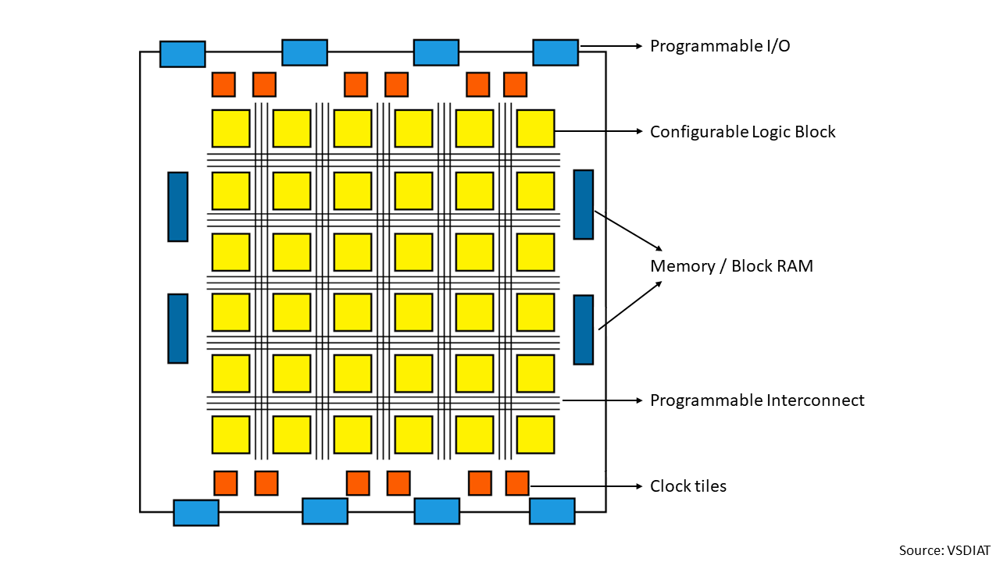
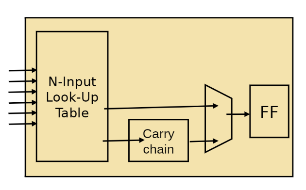
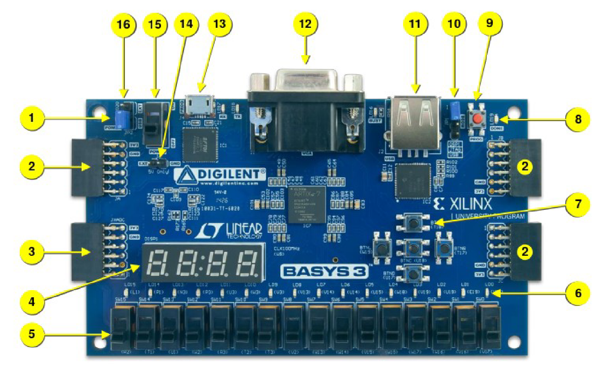
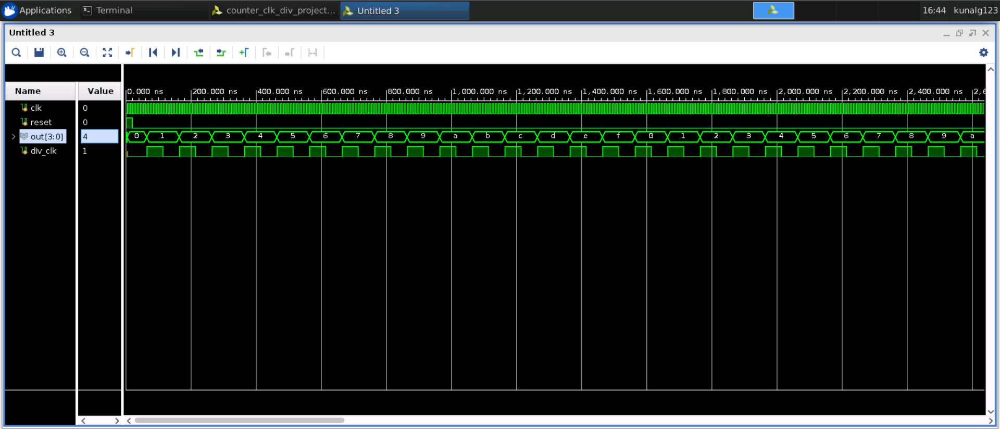
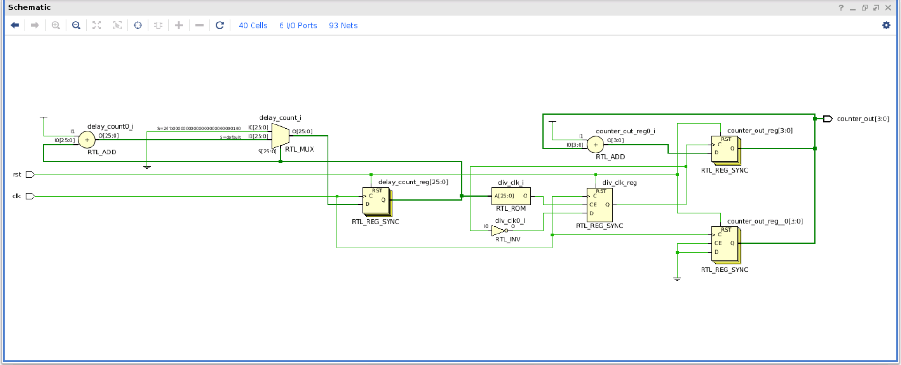
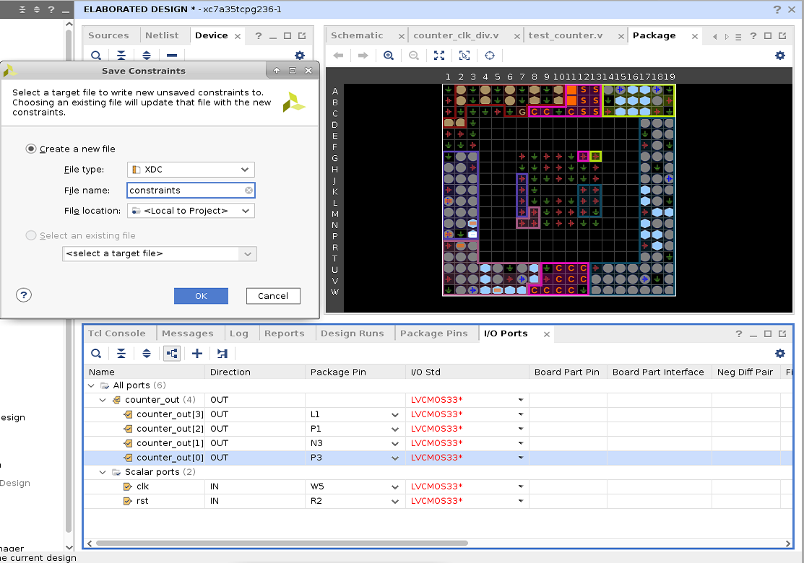
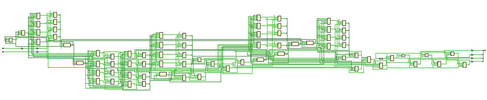
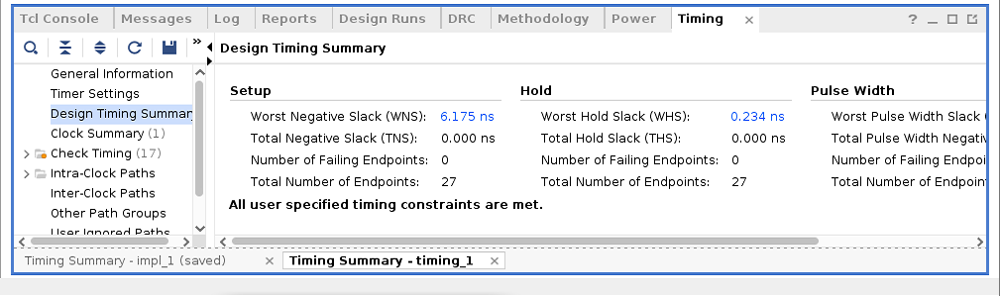
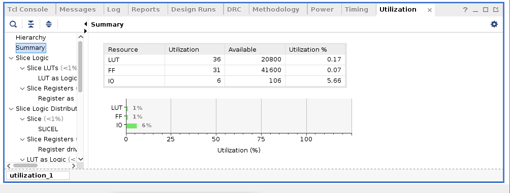
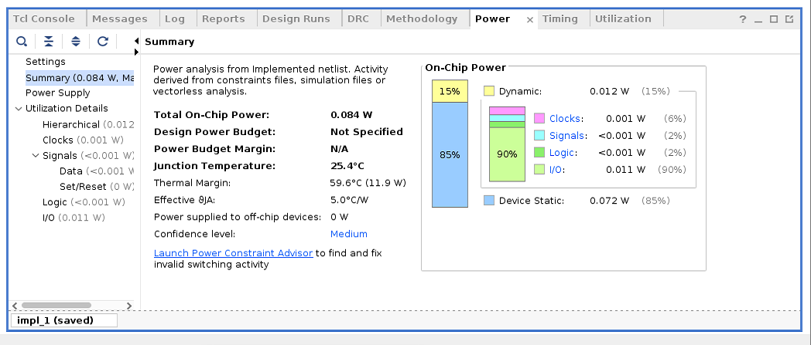

# FPGA Architecture, Fabric Exploration & Implementation Flow

[](LICENSE)
[]()
[]()
[]()
[]()

> A comprehensive technical investigation into FPGA fabric architecture, design methodologies, and implementation toolchains. This work documents complete flows from RTL to Bitstream using both industry-standard commercial tools (Xilinx Vivado for Artix-7) and cutting-edge open-source EDA platforms (OpenFPGA, VTR/VPR, and SkyWater 130nm SOFA fabric), culminating in the deployment of a 4-stage pipelined RISC-V RV32I processor core (`RVMYTH`).

---

## Table of Contents

- [Architectural Overview](#architectural-overview)
  - [FPGA vs. ASIC Architectural Trade-offs](#fpga-vs-asic-architectural-trade-offs)
  - [Island-Style FPGA Architecture](#island-style-fpga-architecture)
- [Workshop Roadmap & Methodology](#workshop-roadmap--methodology)
  - [Day 1 - FPGA Architectural Foundations & Xilinx Vivado Flow](#day-1---fpga-architectural-foundations--xilinx-vivado-flow)
  - [Day 2 - Open-Source CAD Toolchains: OpenFPGA, VPR & VTR Flow](#day-2---open-source-cad-toolchains-openfpga-vpr--vtr-flow)
  - [Day 3 - RISC-V RV32I Core (RVMYTH) Implementation in Vivado](#day-3---risc-v-rv32i-core-rvmyth-implementation-in-vivado)
  - [Day 4 - SkyWater 130nm SOFA Open-Source FPGA Fabric Exploration](#day-4---skywater-130nm-sofa-open-source-fpga-fabric-exploration)
  - [Day 5 - Full-Flow RVMYTH RISC-V Mapping on Custom SOFA Fabric](#day-5---full-flow-rvmyth-risc-v-mapping-on-custom-sofa-fabric)
- [Repository Structure](#repository-structure)
- [References](#references)
- [Acknowledgements](#acknowledgements)

---

## Architectural Overview

Field-Programmable Gate Arrays (FPGAs) are semiconductor devices based on a matrix of Configurable Logic Blocks (CLBs) connected via programmable interconnects. Unlike Application-Specific Integrated Circuits (ASICs), where circuits are permanently etched into silicon during fabrication, FPGAs offer reconfigurability after manufacturing, making them indispensable for prototyping, high-throughput DSP, software-defined networking, and agile hardware acceleration.

### FPGA vs. ASIC Architectural Trade-offs

| Engineering Metric | Field-Programmable Gate Array (FPGA) | Application-Specific Integrated Circuit (ASIC) |
| :--- | :--- | :--- |
| **Circuit Implementation** | SRAM-programmed lookup tables (LUTs) & routing switches | Custom silicon masks (standard cells & full custom) |
| **Development Turnaround** | Minutes to hours (RTL to Bitstream) | Months to years (RTL to GDSII to Fab) |
| **Non-Recurring Engineering (NRE)** | Minimal; standard off-the-shelf silicon | Extremely high ($100k - $10M+ for masks) |
| **Unit Cost at Scale** | Higher per chip for massive production volumes | Very low at high volumes ($1 - $10M units) |
| **Silicon Efficiency** | Overhead due to configuration SRAM & routing switches | Maximum logic density per mm² silicon area |
| **Operating Frequency ($f_{MAX}$)** | Typically 50 MHz – 500 MHz | Can exceed 1 GHz – 3+ GHz |
| **Power Efficiency** | Higher static and dynamic power per operation | Highly optimized for ultra-low power consumption |
| **Post-Silicon Flexibility** | Full remote in-field reconfigurability & feature updates | Hardware is fixed; requires new silicon spin |

### Island-Style FPGA Architecture

Modern commercial and open-source FPGAs adhere to an **island-style (mesh-based)** topology. In this architecture, logic clusters are organized as a 2D regular grid surrounded by vertical and horizontal routing channels.

```
       +-------+      +-------+      +-------+
       |  IOB  |      |  IOB  |      |  IOB  |
       +---v---+      +---v---+      +---v---+
           |              |              |
+-----+----+--------------+--------------+----+-----+
| IOB |--[ SB ]--------- [ SB ]--------- [ SB ]--| IOB |
+-----+    |              |              |    +-----+
           |   +------+   |   +------+   |
         [ CB ]|  CLB | [ CB ]|  CLB | [ CB ]
           |   +------+   |   +------+   |
+-----+----+--------------+--------------+----+-----+
| IOB |--[ SB ]--------- [ SB ]--------- [ SB ]--| IOB |
+-----+    |              |              |    +-----+
           |              |              |
       +---^---+      +---^---+      +---^---+
       |  IOB  |      |  IOB  |      |  IOB  |
       +-------+      +-------+      +-------+
```

An island-style architecture primarily consists of:
1. **Configurable Logic Blocks (CLBs)**: The fundamental computational element, containing Look-Up Tables (LUTs) for arbitrary boolean logic, dedicated carry chains (`CARRY4`) for arithmetic, multiplexers, and flip-flops/latches.
2. **Connection Blocks (CB)**: Connect logic block inputs/outputs to adjacent routing channels.
3. **Switch Blocks (SB)**: Programmable switch matrices positioned at channel intersections to route nets across orthogonal tracks.
4. **Input/Output Blocks (IOBs)**: Configurable I/O pads supporting diverse voltage standards (LVCMOS, LVDS, etc.).

<p align="center">
  
  <br>
  <em>Figure 1: Island-style FPGA grid showing logic clusters, routing channels, and switch matrices.</em>
</p>

### Configurable Logic Block (CLB) Sub-Architecture

Inside each CLB:
- **$K$-input Look-Up Tables ($K$-LUTs)**: Implement any $K$-variable boolean function as a truth table stored in SRAM cells.
- **Dedicated Carry Logic**: Fast lookahead carry generators enabling low-latency adders and counters.
- **Sequential Elements**: Configurable D flip-flops with synchronous/asynchronous set, reset, and clock enable controls.

<p align="center">
  
  <br>
  <em>Figure 2: Microarchitecture of a Configurable Logic Block (LUTs, MUXes, Flip-Flops).</em>
</p>

---

## Workshop Roadmap & Methodology

This project presents a multi-stage exploration of modern FPGA flows:
- **Day 1**: Commercial FPGA exploration on Digilent Basys 3 using Xilinx Vivado.
- **Day 2**: Open-source EDA tools (OpenFPGA, VPR, and VTR flow) with timing and power analysis.
- **Day 3**: RTL-to-Bitstream compilation of a 4-stage pipelined RISC-V processor (`RVMYTH`).
- **Day 4**: Open-source SkyWater 130nm SOFA fabric exploration.
- **Day 5**: End-to-end mapping of the RISC-V processor onto custom SOFA silicon.

---

## Day 1 - FPGA Architectural Foundations & Xilinx Vivado Flow

The primary goal of Day 1 is to master the commercial FPGA design cycle using the **Digilent Basys 3** development platform powered by the **Xilinx Artix-7 (XC7A35T-1CPG236C)** FPGA.

### Target Hardware: Digilent Basys 3

The Basys 3 is an entry-level development board designed specifically around the Artix-7 architecture:
- **Logic Cells**: 33,280 (in 5,200 slices; each slice containing four 6-input LUTs and eight flip-flops)
- **Fast Block RAM**: 1,800 Kbits
- **Clock Management Tiles (CMT)**: 5 (each containing a PLL and Mixed-Mode Clock Manager - MMCM)
- **DSP Slices**: 90 (18 x 25 multiplier blocks)
- **Internal Clock Speed**: Exceeding 450 MHz

<p align="center">
  
  <br>
  <em>Figure 3: Digilent Basys 3 Artix-7 Board Hardware Peripherals and Pin Assignment Map.</em>
</p>

#### Hardware Peripheral Map

| Callout | Peripheral Component | Callout | Peripheral Component |
| :---: | :--- | :---: | :--- |
| **01** | Power Good Indicator LED | **09** | FPGA System Reset Button |
| **02** | Pmod Header Group A | **10** | Programming Mode Jumper |
| **03** | Pmod Header Group B | **11** | FTDI USB-JTAG / UART Interface |
| **12** | 12-bit VGA Display Port | **04** | Four-Digit 7-Segment Display |
| **13** | USB Host Interface (HID) | **05** | 16 Slide Switches (SW0 - SW15) |
| **14** | External 5V Power Connector | **06** | 16 User LEDs (LD0 - LD15) |
| **15** | Main Power Switch | **07** | 5 Pushbuttons (Center, U, D, L, R) |
| **16** | Power Source Select Jumper | **08** | FPGA Configuration Done LED |

---

### RTL Design: 4-Bit Synchronous Counter with Clock Division

Because the onboard oscillator generates a high-frequency **100 MHz clock** ($T = 10 \text{ ns}$), driving an LED counter directly would cause state transitions faster than human visual persistence. A clock division module is implemented in Verilog to generate an observable low-frequency clock.

```verilog
`timescale 1ns / 1ps

module counter_clk_div #(
    parameter integer DELAY_MAX = 212
)(
    input  wire       clk,
    input  wire       rst,
    output reg  [3:0] counter_out
);
    reg        div_clk;
    reg [25:0] delay_count;

    // Clock division logic
    always @(posedge clk) begin
        if (rst) begin
            delay_count <= 26'd0;
            div_clk     <= 1'b0;
        end else begin
            if (delay_count == DELAY_MAX) begin
                delay_count <= 26'd0;
                div_clk     <= ~div_clk;
            end else begin
                delay_count <= delay_count + 1'b1;
            end
        end
    end

    // 4-bit synchronous up-counter
    always @(posedge div_clk) begin
        if (rst) begin
            counter_out <= 4'b0000;
        end else begin
            counter_out <= counter_out + 1'b1;
        end
    end
endmodule
```

The mathematical relationship governing the divided frequency is:
$$f_{\text{div}} = \frac{f_{\text{in}}}{2 \times (\text{DELAY\_MAX} + 1)}$$

---

### Behavioral Simulation & RTL Elaboration

1. **Behavioral Simulation**: Verifies the functional correctness of the RTL before physical synthesis. The counter increments predictably on rising edges of `div_clk`, and resets synchronously when `rst` is asserted.

<p align="center">
  
  <br>
  <em>Figure 4: Vivado Behavioral Simulation verifying clock division and sequential counter counting.</em>
</p>

2. **RTL Elaboration**: Resolves Verilog hierarchies, instantiates primitives, checks connectivity, and builds the generic logical structure without technology-specific mapping.

<p align="center">
  
  <br>
  <em>Figure 5: Elaborated Gate-Level Schematic of the counter and clock divider module.</em>
</p>

3. **I/O Planning**: Maps top-level module ports (`clk`, `rst`, `counter_out[3:0]`) to physical FPGA pins on the CPG236 package with appropriate I/O standards (`LVCMOS33`).

<p align="center">
  
  <br>
  <em>Figure 6: Vivado I/O Planning assigning ports to Artix-7 package pads.</em>
</p>

---

### Logic Synthesis & Constraints

Logic synthesis transforms the elaborated generic logic into an optimal gate-level netlist using target Artix-7 primitives (`LUT6`, `FDRE`, `CARRY4`, `IBUF`, `OBUF`).

<p align="center">
  
  <br>
  <em>Figure 7: Synthesized netlist mapped to Xilinx Artix-7 technology primitives.</em>
</p>

#### Timing Constraints (`basys3_master.xdc`)
Constraints specify the physical and timing boundaries of the design, ensuring proper setup and hold slack closure:
```tcl
## 100 MHz Master System Clock Constraint (10 ns period)
set_property PACKAGE_PIN W5 [get_ports clk]							
set_property IOSTANDARD LVCMOS33 [get_ports clk]
create_clock -add -name sys_clk_pin -period 10.00 -waveform {0 5} [get_ports clk]

## Reset Pin Mapping
set_property PACKAGE_PIN V17 [get_ports rst]					
set_property IOSTANDARD LVCMOS33 [get_ports rst]

## 4-bit Counter Output Pin Mapping (LEDs LD0 - LD3)
set_property PACKAGE_PIN U16 [get_ports {counter_out[0]}]					
set_property IOSTANDARD LVCMOS33 [get_ports {counter_out[0]}]
set_property PACKAGE_PIN E19 [get_ports {counter_out[1]}]					
set_property IOSTANDARD LVCMOS33 [get_ports {counter_out[1]}]
set_property PACKAGE_PIN U19 [get_ports {counter_out[2]}]					
set_property IOSTANDARD LVCMOS33 [get_ports {counter_out[2]}]
set_property PACKAGE_PIN V19 [get_ports {counter_out[3]}]					
set_property IOSTANDARD LVCMOS33 [get_ports {counter_out[3]}]
```

---

### Implementation, Timing Closure & Power Analysis

Physical implementation translates the synthesized netlist into the target FPGA fabric across three major phases:
1. **Logic Optimization (`opt_design`)**: Prunes unused logic and optimizes constant nets.
2. **Placement (`place_design`)**: Assigns logic primitives to specific CLB slices in the silicon floorplan.
3. **Routing (`route_design`)**: Allocates routing tracks and programmable interconnect switches.

#### Post-Implementation Timing Summary
The design comfortably satisfies all timing requirements:
- **Worst Negative Slack (WNS)**: Positive slack ($\gg 0\text{ ns}$), indicating zero setup violations.
- **Worst Hold Slack (WHS)**: Positive slack, confirming zero hold-time violations.

<p align="center">
  
  <br>
  <em>Figure 8: Post-Implementation Timing Summary showing positive timing margins.</em>
</p>

#### Resource Utilization
Device utilization shows minimal hardware consumption, leaving over 99% of Artix-7 resources available for additional logic:

<p align="center">
  
  <br>
  <em>Figure 9: Artix-7 Device Utilization Summary (LUTs, FFs, I/O Buffers).</em>
</p>

#### On-Chip Power Dissipation
Total on-chip power is partitioned into:
- **Static Power**: Leakage power inherent to biased silicon transistors.
- **Dynamic Power**: Power consumed due to capacitive charging/discharging during signal transitions:
  $$P_{\text{dynamic}} = \alpha \cdot C_L \cdot V_{DD}^2 \cdot f$$

<p align="center">
  
  <br>
  <em>Figure 10: On-chip power breakdown generated by Vivado Power Analyzer.</em>
</p>

---

### In-System Debugging: Virtual Input/Output (VIO)

In complex FPGA designs without sufficient physical switches or LEDs, the **Virtual Input/Output (VIO)** core provides an on-chip debugging interface. The VIO core runs directly in FPGA logic and communicates over the JTAG boundary scan chain, allowing designers to dynamically drive input signals and monitor internal registers via Vivado Hardware Manager in real time without recompilation.

---